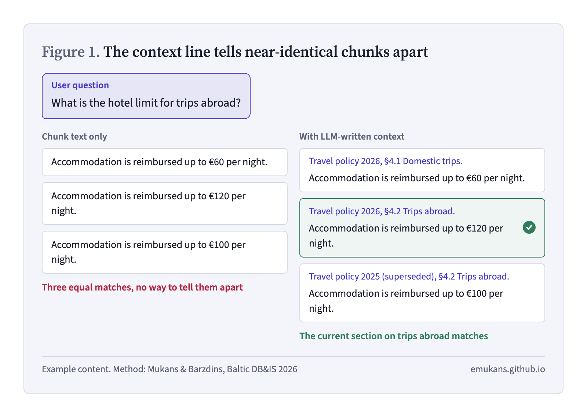
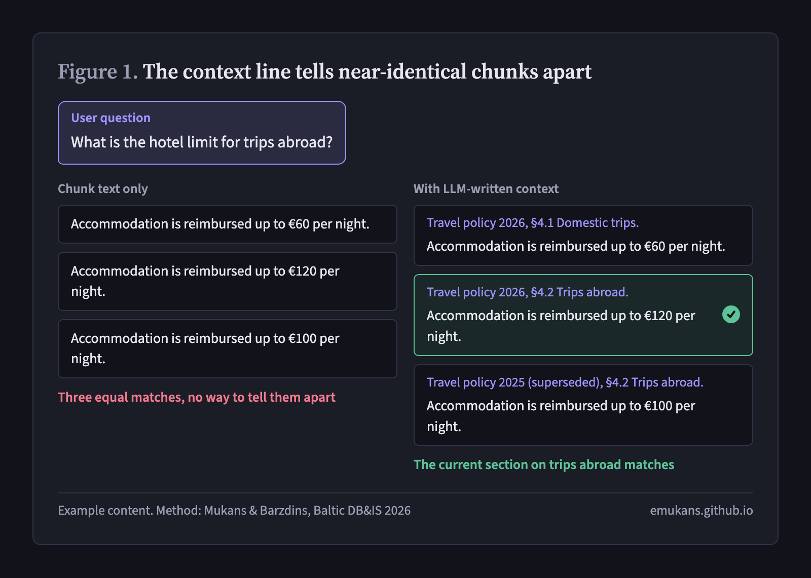

The [previous post](/posts/multi-vector/) covered multi-vector indexing from our paper [*Engineering a Production RAG-Based Agent Platform*](https://ceur-ws.org/Vol-4211/paper05.pdf) [1]. This one covers the stage just before it: **contextual enrichment**, where an LLM writes a short document-level context for each chunk before the chunk is embedded.

## The problem: a chunk forgets its document

An illustrative example. A travel policy has a section on domestic trips and one on trips abroad, and the knowledge base also still holds last year's version. After chunking, three chunks read almost the same:

> Accommodation is reimbursed up to €60 per night.
>
> Accommodation is reimbursed up to €120 per night.
>
> Accommodation is reimbursed up to €100 per night.

A user asks *"What is the hotel limit for trips abroad?"*. All three chunks are equally close to the question, because the words that tell them apart (abroad, 2026, the section heading) are in the document, not in the chunk.

Choi et al. call the fix *decontextualization*: a sentence taken out of its document often can't be understood on its own and has to be rewritten so it can [2]. Contextual enrichment does a version of this for retrieval.

{: .light width="800" height="571" }
{: .dark width="800" height="571" }
_Figure 1. The context line carries the words that tell near-identical chunks apart._

## Anthropic's contextual retrieval

We follow Anthropic's *contextual retrieval* [3]. The method is simple:

1. For each chunk, an LLM gets the whole document and the chunk, and is asked for a short context that situates the chunk within the document, for the purpose of improving search retrieval. Anthropic used Claude 3 Haiku.
2. The answer, usually 50–100 tokens, is prepended to the chunk.
3. The combined text goes into both the embedding index and the BM25 index ("contextual BM25").
4. At query time nothing changes. Anthropic retrieved the top 150 candidates, re-ranked them with a cross-encoder and kept the top 20.

Because every chunk of a document is sent with the same document, Anthropic uses prompt caching: the document is loaded once and reused for all its chunks.

Their evaluation covered codebases, fiction, scientific papers and arXiv papers, and measured how often a relevant chunk was missing from the top 20 (1 − recall@20). They report:

| Setup | Top-20 failure rate |
| --- | --- |
| Embeddings + BM25 | 5.7% |
| Contextual embeddings | 3.7% |
| Contextual embeddings + contextual BM25 | 2.9% |
| … + re-ranking | 1.9% |

These are Anthropic's numbers on their own datasets, published on their engineering blog rather than in a peer-reviewed venue. Two of their recommendations matter for a platform: the generic prompt works, but a prompt tailored to the domain can do better (for example, with a glossary of terms defined in other documents); and a knowledge base under about 200,000 tokens may not need retrieval at all, since it fits in the prompt.

## How we use it

In the platform, enrichment is stage 4 of five ingestion stages: parse, chunk, deduplicate, enrich, embed. An LLM writes 50–100 tokens of document-level context for each chunk, and the contextualised text is what stage 5 embeds as the chunk's direct vector, next to its question vectors [1].

The enrichment prompt can be configured per domain if needed. Prompts are versioned and stored in MLflow.

The idea is close to my doctoral research on LLMs for input context enrichment. In shared tasks, a large LLM generated extra context for each input and a smaller model was trained on the enriched data: GPT-3 context for NER [4], GPT-4-generated data for adverse drug event detection [5], and LLM-generated insights that improved a classifier even though the LLM was not used at inference time [6]. In RAG, the smaller model is the embedding model: the LLM reads the whole document once and writes down what the embedding model can't see in the chunk.

The paper reports deployment experience, not a controlled ablation, so there is no recall number of our own to quote.

## Other ways to give a chunk its context

LLM-written context is one of several ways to make a chunk carry its document. The main alternatives differ in where the context comes from and whether they change the chunk text.

**Title prepending.** The simplest fix is to put the document title in front of every chunk. Dense Passage Retrieval, one of the first widely used dense retrievers for question answering, already embedded each Wikipedia passage together with its article title [7]. It is free and worth doing anyway, but a title says which document a chunk is from, not which section or which version, and in our example two of the three chunks share the same title.

**Rewriting the chunk.** Decontextualization [2] and propositions [8] go further and rewrite the text into self-contained units; Chen et al. found that indexing propositions retrieves better than indexing passages. We keep the original chunk and only add to it, because the chunk is also what the generator reads and what the answer cites. An added line can be wrong, but the source text under it stays intact.

**Late chunking.** Instead of an LLM, the embedding model itself sees the document: the whole document is encoded at once and the token embeddings are pooled per chunk afterwards [9]. Merola and Singh compared it with contextual retrieval on a subset of NFCorpus [9]. Contextual retrieval came out ahead on retrieval (NDCG@5 0.317 against 0.309 for the best late-chunking setup), at a higher compute cost, and late chunking was sometimes worse than plain chunking, depending on the model. Differences in answer quality were not significant. For us the deciding point is practical. Late chunking needs a vector for every token of the whole document, which it then averages per chunk. The hosted embedding APIs we use return only one finished vector per input text, so there are no token vectors to average. Using late chunking would mean running our own long-context embedding model instead of choosing a provider per knowledge base.

**Contextual document embeddings.** Morris and Rush add a different kind of context: the encoder is trained to also see neighbouring documents from the same corpus, so an embedding reflects what is typical in that corpus [10]. It addresses domain shift rather than a lost section heading, and it needs its own model, so it is not a drop-in for a configurable embedding provider.

**RAPTOR** works at a different level: it clusters chunks, has an LLM summarise each cluster, and indexes the summaries as a tree, so a broad question can match a summary instead of a detail [11]. It complements per-chunk context rather than replacing it.

If you've tried contextual retrieval or late chunking in your own RAG system, I'd like to hear what worked and what didn't.

## Citation

```bibtex
@inproceedings{mukans-agents-2026,
  author    = {Mukans, Eduards and Barzdins, Guntis},
  title     = {Engineering a Production {RAG}-Based Agent Platform},
  booktitle = {Joint Proceedings of Baltic DB\&IS Conference Forum and
               Doctoral Consortium 2026},
  editor    = {Nikiforova, Anastasija and Iqbal, Mubashar and
               Kalibatien{\.e}, Diana and Kornyshova, Elena and
               Robal, Tarmo and Matulevi{\v{c}}ius, Raimundas and
               Liiv, Innar},
  series    = {CEUR Workshop Proceedings},
  volume    = {4211},
  pages     = {43--54},
  address   = {Tartu, Estonia},
  publisher = {CEUR-WS.org},
  year      = {2026},
  url       = {https://ceur-ws.org/Vol-4211/paper05.pdf},
}
```

## References

1. E. Mukans, G. Barzdins. Engineering a production RAG-based agent platform. In *Joint Proceedings of Baltic DB&IS Conference Forum and Doctoral Consortium 2026*, CEUR Workshop Proceedings, vol. 4211, pp. 43–54, 2026. [CEUR-WS](https://ceur-ws.org/Vol-4211/paper05.pdf)
2. E. Choi, J. Palomaki, M. Lamm, T. Kwiatkowski, D. Das, M. Collins. Decontextualization: Making sentences stand-alone. *Transactions of the Association for Computational Linguistics*, 9:447–461, 2021. [doi:10.1162/tacl_a_00377](https://doi.org/10.1162/tacl_a_00377)
3. Anthropic. Introducing contextual retrieval. Engineering blog, 2024. [anthropic.com](https://www.anthropic.com/engineering/contextual-retrieval)
4. E. Mukans, G. Barzdins. RIGA at SemEval-2023 Task 2: NER enhanced with GPT-3. In *Proceedings of SemEval-2023*, pp. 331–339. ACL, 2023. [doi:10.18653/v1/2023.semeval-1.45](https://doi.org/10.18653/v1/2023.semeval-1.45)
5. E. Mukans, G. Barzdins. RIGA at SMM4H-2024 Task 1: Enhancing ADE discovery with GPT-4. In *Proceedings of the 9th SMM4H Workshop and Shared Tasks*, pp. 23–27. ACL, 2024. [ACL Anthology](https://aclanthology.org/2024.smm4h-1.6/)
6. E. Mukans, G. Barzdins. RIGA at SMM4H-HeaRD 2025: Context-enriched classification pipeline. In *Workshop Proceedings of the 19th International AAAI Conference on Web and Social Media (ICWSM)*, 2025. [doi:10.36190/2025.66](https://doi.org/10.36190/2025.66)
7. V. Karpukhin, B. Oğuz, S. Min, P. Lewis, L. Wu, S. Edunov, D. Chen, W. Yih. Dense passage retrieval for open-domain question answering. In *Proceedings of EMNLP 2020*, pp. 6769–6781. ACL, 2020. [doi:10.18653/v1/2020.emnlp-main.550](https://doi.org/10.18653/v1/2020.emnlp-main.550)
8. T. Chen, H. Wang, S. Chen, W. Yu, K. Ma, X. Zhao, H. Zhang, D. Yu. Dense X retrieval: What retrieval granularity should we use? In *Proceedings of EMNLP 2024*, pp. 15159–15177. ACL, 2024. [doi:10.18653/v1/2024.emnlp-main.845](https://doi.org/10.18653/v1/2024.emnlp-main.845)
9. C. Merola, J. Singh. Reconstructing context: Evaluating advanced chunking strategies for retrieval-augmented generation. In *Knowledge-Enhanced Information Retrieval (KEIR 2025)*, LNCS, pp. 3–18. Springer, 2025. [doi:10.1007/978-3-032-02899-0_1](https://doi.org/10.1007/978-3-032-02899-0_1)
10. J. X. Morris, A. M. Rush. Contextual document embeddings. In *ICLR 2025*. [Proceedings](https://proceedings.iclr.cc/paper_files/paper/2025/hash/f79df6cbc6e5f708440004fad7ef64cc-Abstract-Conference.html)
11. P. Sarthi, S. Abdullah, A. Tuli, S. Khanna, A. Goldie, C. D. Manning. RAPTOR: Recursive abstractive processing for tree-organized retrieval. In *ICLR 2024*. [Proceedings](https://proceedings.iclr.cc/paper_files/paper/2024/hash/8a2acd174940dbca361a6398a4f9df91-Abstract-Conference.html)
